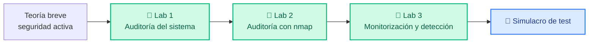

# Unidad 2 · Seguridad activa: auditoría y detección

| | |
|---|---|
| **Resultado de aprendizaje** | RA2 · Implanta mecanismos de seguridad activa |
| **Trimestre** | 1.º — se evalúa con **examen tipo test** |
| **Duración** | 16 horas |
| **Herramientas** | Python 3 · `psutil` · `nmap` · Docker Compose |

Esta unidad trata de **defender un sistema en marcha**: entender cómo se audita una red (qué equipos y servicios hay, si son vulnerables) y cómo se **detecta** un ataque leyendo lo que deja en los registros. Lo harás con **dos laboratorios** cortos y guiados paso a paso: primero te pones del lado del **auditor** (descubres y escaneas), y luego del lado del **defensor** (detectas en los logs lo que el auditor hizo). Son las dos caras de la misma moneda.

La evaluación es un **examen tipo test**; al final tienes un simulacro con el mismo formato.

## Cómo está organizada



## Preparación del entorno

Necesitas **Python 3** y **Docker** (con Docker Compose). Comprueba que están:

```bash
python --version          # 3.10 o superior
docker --version
docker compose version
```

Los dos laboratorios traen todos sus ficheros en las carpetas `labs/lab2/` y `labs/lab3/` del repositorio. Para el código Python que ejecutes fuera de Docker, crea un entorno virtual con una sola dependencia:

```text title="requirements.txt"
psutil==5.9.8
```

```bash
python -m venv .venv
source .venv/bin/activate      # Windows: .venv\Scripts\activate
pip install -r requirements.txt
```

!!! info "Solo una dependencia externa"
    En esta unidad lo único que se instala con `pip` es **psutil** (Lab 1, auditoría del sistema). El Lab 2 usa **nmap**, la herramienta estándar de escaneo, que se instala dentro de su contenedor. El Lab 3 solo usa la **biblioteca estándar** de Python (expresiones regulares, conteo, ficheros).

!!! info "Cómo se usan los laboratorios (resumen)"
    Cada laboratorio sigue siempre el mismo ciclo de tres comandos, desde la carpeta del lab:

    - **Arrancar:** `docker compose up -d --build` — construye y deja el contenedor vivo en segundo plano.
    - **Entrar y trabajar:** `docker compose exec <servicio> bash` — abres una terminal **como root** dentro del contenedor; ahí ejecutas los scripts (`python ...`) y, si quieres, instalas paquetes con `apt-get`.
    - **Parar:** `exit` para salir del contenedor y `docker compose down` para detenerlo y eliminarlo.

    El nombre del `<servicio>` es `auditor` en los labs 1 y 2, y `analista` en el lab 3 (lo ves en el `compose.yaml`). Los contenedores quedan **rulando** hasta que hagas `docker compose down`.

!!! danger "Norma de uso"
    Todo esto se practica **solo** dentro de los contenedores del laboratorio o en tu propia máquina. Escanear o auditar equipos ajenos sin permiso es delito. Ver [Uso ético y legal](../recursos/uso-etico.md).

## Teoría breve: seguridad activa

La **seguridad activa** son las medidas que **previenen o detienen** un incidente *mientras el sistema funciona* (un firewall que corta una conexión, un antivirus que bloquea un fichero, un sistema que detecta un ataque). Se distingue de la **seguridad pasiva**, que **reduce el daño una vez ocurrido** (copias de seguridad, redundancia, un SAI).

| | Seguridad activa | Seguridad pasiva |
|---|---|---|
| Cuándo actúa | **Antes y durante** el incidente | **Después** del incidente |
| Ejemplos | Firewall, antivirus, IDS/IPS | Copias de seguridad, redundancia, SAI |

Tres conceptos que conviene no confundir:

- **Amenaza:** lo que podría causar daño (un atacante, un malware). No la controlas.
- **Vulnerabilidad:** la debilidad que la amenaza aprovecha (un servicio sin actualizar). **Sí** la controlas.
- **Riesgo:** la probabilidad de que una amenaza explote una vulnerabilidad, por su impacto.

Y los mecanismos de defensa que aparecen en los laboratorios:

| Mecanismo | Qué hace |
|---|---|
| **Escáner / auditoría** | Descubre qué equipos y servicios hay, y si son vulnerables (Lab 1) |
| **IDS** (*Intrusion Detection System*) | **Detecta** actividad sospechosa en los registros y **avisa** (Lab 2) |
| **IPS** | Detecta **y además bloquea** el ataque |
| **NVD** (*National Vulnerability Database*) | Base pública de vulnerabilidades conocidas (los **CVE**) |

Dos diferencias que caen en el test: un **IDS** solo avisa, un **IPS** avisa y bloquea; y un **CVE** es el identificador público de una vulnerabilidad concreta (por ejemplo, `CVE-2021-23017`).
## 🧪 Lab 1 · Auditoría del propio sistema

**Objetivo.** Empezar por lo más cercano: **mirar tu propia máquina**. Antes de vigilar una red, un administrador audita el equipo: cuánta CPU y memoria se usan, qué procesos corren. Lo harás con **`psutil`**, la librería estándar para esto.

!!! tip "Ficheros del laboratorio"
    Están en `labs/lab1/`: `auditor_sistema.py`, `Dockerfile`, `compose.yaml` y `requirements.txt`.

### Paso 1 · El auditor del sistema

```python title="labs/lab1/auditor_sistema.py"
import psutil
import platform

print("=== Auditoría del sistema ===")
print("SO:", platform.system(), platform.release())
print("CPU:", psutil.cpu_percent(interval=0.3), "%")

mem = psutil.virtual_memory()
print(f"Memoria: {mem.percent}% usada ({mem.used // (1024**2)} MB de {mem.total // (1024**2)} MB)")

print("\n-- Procesos que más memoria usan --")
procesos = []
for p in psutil.process_iter(["pid", "name", "memory_percent"]):
    try:
        procesos.append((p.info["memory_percent"] or 0.0, p.info["pid"], p.info["name"]))
    except (psutil.NoSuchProcess, psutil.AccessDenied):
        continue
for mem_pct, pid, nombre in sorted(procesos, reverse=True)[:3]:
    print(f"  PID {pid:6}  {nombre:20}  {mem_pct:.1f}%")

print(f"\nTotal de procesos visibles: {len(procesos)}")
print("(Dentro de un contenedor, estos son los procesos DE ESE contenedor.)")
```

Tres detalles importantes:

- **`cpu_percent(interval=0.3)`** mide durante 0,3 s. Sin `interval`, la primera llamada devolvería `0.0` (no tiene un instante anterior con el que comparar).
- **`virtual_memory()`** da los valores en **bytes**; por eso dividimos entre `1024**2` para pasar a MB.
- El bucle **captura `NoSuchProcess` y `AccessDenied`**: un proceso puede terminar mientras lo leemos, o estar protegido. Sin ese `try/except`, el programa se rompería.

### Paso 2 · Levanta y ejecuta

```bash title="Terminal (dentro de labs/lab1/)"
# 1) Construye la imagen y levanta el contenedor (queda vivo en segundo plano)
docker compose up -d --build

# 2) Entra al contenedor (eres root: puedes instalar con apt si quieres)
docker compose exec auditor bash

# 3) Ya DENTRO del contenedor, ejecuta el script:
python auditor_sistema.py
```

**Salida esperada** (los números varían según tu máquina):

```text
=== Auditoría del sistema ===
SO: Linux 6.1.0
CPU: 0.0 %
Memoria: 3.1% usada (120 MB de 3997 MB)

-- Procesos que más memoria usan --
  PID      1  python                0.4%

Total de procesos visibles: 1
(Dentro de un contenedor, estos son los procesos DE ESE contenedor.)
```

### Paso 3 · Compara dentro y fuera del contenedor

Ejecuta ahora el mismo script **directamente en tu máquina** (sin Docker, con el entorno virtual activado):

```bash title="Terminal"
python labs/lab1/auditor_sistema.py
```

Verás **muchos más procesos**. ¿Por qué? Porque un contenedor está **aislado**: solo ve *sus propios* procesos, no los del equipo anfitrión. Para auditar la máquina real hay que ejecutar el script fuera de Docker.

!!! warning "Un proceso desconocido NO es automáticamente malicioso"
    Ver un proceso con un nombre que no reconoces es normal: el sistema ejecuta decenas de procesos legítimos. La auditoría da **datos**, no veredictos. Antes de alarmarte, investiga (qué ejecutable es, qué usuario lo lanza).

### Paso 4 · Apaga el laboratorio

```bash
# Primero sal del contenedor (si estás dentro):
exit
# Luego detén y elimina los contenedores:
docker compose down
```

!!! success "Lo que has hecho"
    Una auditoría básica del sistema: CPU, memoria y procesos. Es la primera capa de la monitorización, y has visto de paso que un contenedor está aislado del anfitrión.

## 🧪 Lab 2 · Auditoría de la red con nmap

**Objetivo.** Ponerte del lado del **auditor** usando la herramienta real que se emplea en el mundo profesional: **nmap**, el escáner de puertos y servicios más usado. Descubrirás qué puertos tiene abiertos un servidor, qué software y versión corre en ellos, y cruzarás esa información con una base de vulnerabilidades (la **NVD**) para generar un informe.

**Qué monta el laboratorio.** Dos contenedores en la misma red: un **servidor** (nginx) y el **auditor**, que lleva **nmap** ya instalado.

!!! tip "Ficheros del laboratorio"
    Están en `labs/lab2/`: `informe.py`, `Dockerfile` y `compose.yaml`. El `Dockerfile` instala nmap por ti.

### Paso 1 · Mira el laboratorio

El `compose.yaml` define el servidor y el auditor:

```yaml title="labs/lab2/compose.yaml"
services:
  # Objetivo de la auditoría: un servidor web con una versión concreta de nginx.
  servidor:
    image: nginx:1.18.0
    ports:
      - "8080:80"        # abre http://localhost:8080 en el navegador
    networks:
      - laboratorio

  # El auditor lleva nmap instalado. Corre como root y permanece vivo.
  auditor:
    build: .
    depends_on:
      - servidor
    networks:
      - laboratorio

networks:
  laboratorio:
```

El `Dockerfile` del auditor instala nmap:

```dockerfile title="labs/lab2/Dockerfile"
FROM python:3.12-slim
WORKDIR /app
RUN apt-get update && apt-get install -y --no-install-recommends nmap \
    && rm -rf /var/lib/apt/lists/*
COPY informe.py .
CMD ["sleep", "infinity"]
```

### Paso 2 · Levanta el laboratorio y entra en el auditor

```bash title="Terminal (dentro de labs/lab2/)"
docker compose up -d --build
docker compose exec auditor bash
```

Ya estás **dentro del contenedor auditor**, como root y con nmap listo.

### Paso 3 · Escanea con nmap

**a) Descubrimiento de puertos.** Qué puertos tiene abiertos el servidor:

```bash title="Dentro del contenedor auditor"
nmap servidor
```

```text title="Salida (aproximada)"
Nmap scan report for servidor (172.x.x.x)
PORT   STATE SERVICE
80/tcp open  http
```

nmap ha encontrado el puerto **80 abierto** (el servidor web). `servidor` es el nombre del contenedor en la red Docker.

**b) Detección de versiones** (la clave de una auditoría). La opción `-sV` averigua **qué software y versión** corre en cada puerto:

```bash title="Dentro del contenedor auditor"
nmap -sV servidor
```

```text title="Salida (aproximada)"
PORT   STATE SERVICE VERSION
80/tcp open  http    nginx 1.18.0
```

Ahora sabemos no solo que hay un servidor web, sino que es **nginx 1.18.0**. Con esa versión exacta se pueden buscar sus vulnerabilidades.

### Paso 4 · Genera el informe cruzando con la NVD

nmap puede guardar su resultado en **XML** (`-oX`) para procesarlo con un programa. Lánzalo así y luego ejecuta el informe:

```bash title="Dentro del contenedor auditor"
nmap -sV -oX resultado.xml servidor
python informe.py
```

El script `informe.py` lee ese XML y cruza cada versión con la NVD:

```python title="labs/lab2/informe.py"
import xml.etree.ElementTree as ET

# "NVD local": versiones vulnerables conocidas (extracto, para el laboratorio)
NVD_LOCAL = {
    ("nginx", "1.18.0"): "CVE-2021-23017 (resolver, gravedad alta)",
    ("Apache httpd", "2.4.49"): "CVE-2021-41773 (path traversal, crítico)",
    ("OpenSSH", "7.4"): "CVE-2018-15473 (enumeración de usuarios)",
    ("vsftpd", "2.3.4"): "CVE-2011-2523 (puerta trasera, crítico)",
}

# nmap guardó el resultado del escaneo en este fichero XML
arbol = ET.parse("resultado.xml")

print("=== Informe de auditoría ===\n")
vulnerables = 0
for puerto in arbol.iter("port"):
    estado = puerto.find("state").get("state")
    if estado != "open":
        continue
    servicio = puerto.find("service")
    producto = servicio.get("product", "") if servicio is not None else ""
    version = servicio.get("version", "") if servicio is not None else ""
    cve = NVD_LOCAL.get((producto, version), "")
    marca = f"VULNERABLE: {cve}" if cve else "sin vulnerabilidades conocidas"
    if cve:
        vulnerables += 1
    print(f"  Puerto {puerto.get('portid'):5}  {producto} {version:10}  {marca}")

print(f"\nResumen: {vulnerables} servicio(s) con vulnerabilidades conocidas.")
```

```text title="Salida"
=== Informe de auditoría ===

  Puerto 80     nginx 1.18.0      VULNERABLE: CVE-2021-23017 (resolver, gravedad alta)

Resumen: 1 servicio(s) con vulnerabilidades conocidas.
```

El informe ha detectado que nginx 1.18.0 tiene una vulnerabilidad conocida registrada en la NVD. **Eso es una auditoría**: descubrir → identificar versión → cruzar con vulnerabilidades.

### Paso 5 · Mira la web desde el navegador

El servidor que acabas de auditar es una web real. Como el `compose.yaml` publica su puerto, ábrela en tu navegador:

```text
http://localhost:8080
```

Verás la página de bienvenida de nginx: es lo que había detrás del puerto 80 que nmap marcó como abierto.

### Paso 6 · Apaga el laboratorio

```bash
# Sal del contenedor y detén todo:
exit
docker compose down
```

!!! success "Lo que has hecho"
    Una auditoría real con **nmap**, la herramienta que usan los profesionales: descubrimiento de puertos, detección de versiones (`-sV`) y cruce con la NVD para un informe. Es lo mismo que hacen herramientas como **OpenVAS** o **Nessus**, en pequeño.

> **Si quieres ir más allá:** prueba `nmap -A servidor` (análisis agresivo: sistema operativo, scripts, versiones a la vez) y observa cuánta más información obtiene.

## 🧪 Lab 3 · Monitorización y detección

**Objetivo.** Ahora te pones del lado del **defensor**. En el Lab 2 escaneaste y tanteaste un servidor; esas acciones **dejan rastro** en los registros (*logs*). Aquí vas a **detectarlas** usando primero las herramientas de línea de comandos que usa todo administrador (`grep`, `awk`, `sort`, `uniq`) y luego un pequeño detector en Python. Verás las **dos caras** de la misma acción.

!!! tip "Ficheros del laboratorio"
    Están en `labs/lab3/`: `auth.log`, `web.log`, `detector.py`, `Dockerfile` y `compose.yaml`.

### Paso 1 · Los registros que dejó el atacante

La IP `10.0.0.66` aparece en dos registros. En `auth.log`, intentando adivinar contraseñas:

```text title="labs/lab3/auth.log"
Failed password for root from 10.0.0.66 port 51000
Failed password for root from 10.0.0.66 port 51002
Failed password for admin from 10.0.0.66 port 51004
Failed password for admin from 10.0.0.66 port 51006
Accepted password for ana from 10.0.0.5 port 60000
```

Y en `web.log`, probando rutas que no existen (buscando páginas de administración, backups…):

```text title="labs/lab3/web.log"
10.0.0.66 - GET /index.html 200
10.0.0.66 - GET /admin 404
10.0.0.66 - GET /.env 404
10.0.0.66 - GET /wp-login.php 404
10.0.0.66 - GET /backup.zip 404
10.0.0.5 - GET /index.html 200
```

### Paso 2 · Levanta el laboratorio y entra

```bash title="Terminal (dentro de labs/lab3/)"
docker compose up -d --build
docker compose exec analista bash
```

### Paso 3 · Analiza los logs con herramientas de línea de comandos

Así es como un administrador mira un log rápidamente, sin programar nada. Dentro del contenedor:

**a) ¿Qué IPs han fallado al hacer login, y cuántas veces?**

```bash title="Dentro del contenedor"
grep "Failed password" auth.log | grep -oE "from [0-9.]+" | awk '{print $2}' | sort | uniq -c | sort -rn
```

```text title="Salida"
      4 10.0.0.66
```

Cada orden hace una parte: `grep` filtra las líneas de fallo, `awk` saca la IP, y `sort | uniq -c` las cuenta. La IP `10.0.0.66` ha fallado **4 veces**: patrón de fuerza bruta.

**b) ¿Qué IPs han provocado muchos errores 404 (rutas inexistentes)?**

```bash title="Dentro del contenedor"
grep " 404$" web.log | awk '{print $1}' | sort | uniq -c | sort -rn
```

```text title="Salida"
      4 10.0.0.66
```

La misma IP ha pedido **4 rutas que no existen**: está rastreando el servidor buscando puntos de entrada.

### Paso 4 · Automatiza la detección con Python

Hacerlo a mano está bien para entender, pero conviene automatizarlo. `detector.py` hace lo mismo y lanza una **alerta** cuando se supera un umbral (un mini-IDS):

```python title="labs/lab3/detector.py"
import re
from collections import Counter

UMBRAL = 3

# 1) auth.log: contar fallos de login por IP
fallos = Counter()
with open("auth.log", encoding="utf-8") as f:
    for linea in f:
        m = re.search(r"Failed password .* from (\d+\.\d+\.\d+\.\d+)", linea)
        if m:
            fallos[m.group(1)] += 1

# 2) web.log: contar errores 404 por IP (rutas que no existen)
rutas_404 = Counter()
with open("web.log", encoding="utf-8") as f:
    for linea in f:
        m = re.search(r"(\d+\.\d+\.\d+\.\d+).* 404$", linea.strip())
        if m:
            rutas_404[m.group(1)] += 1

print("Fallos de login por IP:", dict(fallos))
print("Errores 404 por IP:    ", dict(rutas_404))

# 3) Alertas: IP que supera el umbral en login o en rutas
print("\n--- ALERTAS ---")
for ip in sorted(set(fallos) | set(rutas_404)):
    motivos = []
    if fallos[ip] >= UMBRAL:
        motivos.append(f"fuerza bruta ({fallos[ip]} fallos de login)")
    if rutas_404[ip] >= UMBRAL:
        motivos.append(f"rastreo de rutas ({rutas_404[ip]} rutas inexistentes)")
    if motivos:
        print(f"  [ALERTA] {ip}: " + " + ".join(motivos))
```

Ejecútalo:

```bash title="Dentro del contenedor"
python detector.py
```

```text title="Salida"
Fallos de login por IP: {'10.0.0.66': 4}
Errores 404 por IP:     {'10.0.0.66': 4}

--- ALERTAS ---
  [ALERTA] 10.0.0.66: fuerza bruta (4 fallos de login) + rastreo de rutas (4 rutas inexistentes)
```

### Paso 5 · Apaga el laboratorio

```bash
exit
docker compose down
```

!!! success "Las dos caras de la moneda"
    La misma IP (`10.0.0.66`) que en el Lab 2 era *tu auditor*, aquí aparece como *el atacante detectado*: por fuerza bruta en `auth.log` y por rastreo de rutas en `web.log`. **Auditar y detectar son la misma acción vista desde los dos lados.** En el mundo real, herramientas como **fail2ban** hacen esto automáticamente: leen los logs y bloquean la IP que supera un umbral de fallos.

> **Nota sobre falsos positivos.** Superar un umbral es un **patrón sospechoso que hay que verificar**, no una prueba de ataque: podría ser un script mal configurado. Un umbral muy bajo genera falsas alarmas; uno muy alto deja pasar ataques lentos.

## Actividades

> Practica con lo visto en la unidad. Usa solo lo que ya conoces: **variables**, **operadores**, condicionales **`if` / `elif` / `else`** y acceso a **diccionarios**. No necesitas escribir bucles ni definir funciones. Intenta cada una **antes** de abrir la solución.

**1 · 🟢 ¿Activa o pasiva?** Tienes `medida = "firewall"`. Escribe un `if` que imprima `"ACTIVA"` si la medida es `"firewall"`, `"antivirus"` o `"ids"`, y `"PASIVA"` en otro caso.
<details class="sol"><summary>Solución</summary>

```python
medida = "firewall"
if medida in ("firewall", "antivirus", "ids"):
    print("ACTIVA")
else:
    print("PASIVA")
```
</details>

**2 · 🟢 ¿Puerto abierto?** nmap marca cada puerto con un estado. Dado `estado = "open"`, imprime `"ABIERTO"` si el estado es `"open"` y `"cerrado"` en otro caso.
<details class="sol"><summary>Solución</summary>

```python
estado = "open"
if estado == "open":
    print("ABIERTO")
else:
    print("cerrado")
```
</details>

**3 · 🟡 ¿Supera el umbral?** Tienes `fallos = 4` y `umbral = 3`. Imprime `"ALERTA"` si los fallos llegan o superan el umbral, y `"normal"` si no.
<details class="sol"><summary>Solución</summary>

```python
fallos = 4
umbral = 3
if fallos >= umbral:
    print("ALERTA")
else:
    print("normal")
```
</details>

**4 · 🟡 ¿Versión vulnerable?** Tienes un diccionario `nvd = {"nginx/1.18.0": "CVE-2021-23017"}` y una variable `banner = "nginx/1.18.0"`. Imprime el CVE si el banner está en la NVD, y `"sin vulnerabilidades conocidas"` si no.
<details class="sol"><summary>Solución</summary>

```python
nvd = {"nginx/1.18.0": "CVE-2021-23017"}
banner = "nginx/1.18.0"
if banner in nvd:
    print(nvd[banner])
else:
    print("sin vulnerabilidades conocidas")
```
</details>

**5 · 🟠 Clasificar una alerta.** Tienes `tipo = "404"` (el código de una petición web). Imprime `"rastreo de rutas"` si es `"404"`, `"acceso normal"` si es `"200"`, y `"otro"` en cualquier otro caso.
<details class="sol"><summary>Solución</summary>

```python
tipo = "404"
if tipo == "404":
    print("rastreo de rutas")
elif tipo == "200":
    print("acceso normal")
else:
    print("otro")
```
</details>

### Ejercicios propuestos (sin solución)

Ahora tú solo, con las mismas reglas (variables, `if`, sin bucles ni funciones):

**P1 · 🟢** Dada `herramienta = "IDS"`, imprime `"solo avisa"` si es `"IDS"` y `"avisa y bloquea"` si es `"IPS"`.

**P2 · 🟡** Tienes `puertos_distintos = 6` y `umbral = 5`. Imprime `"escaneo de puertos"` si se alcanza el umbral, y `"normal"` si no.

**P3 · 🟠** Dado un diccionario `alerta = {"ip": "10.0.0.66", "motivo": "fuerza bruta"}`, imprime la IP y el motivo solo si el motivo es `"fuerza bruta"` o `"escaneo"`.

## Cómo se evalúa esta unidad (RA2)

La UT1 y la UT2 forman el **1.er trimestre**, que se evalúa con un **examen tipo test** (preguntas de opción múltiple como las del simulacro).

!!! tip "La nota, sin sorpresas"
    **Nota = (aciertos ÷ nº de preguntas) × 10.** Los fallos no restan. Se aprueba con 5.

Los laboratorios no puntúan: son tu forma de entender la materia y de llegar preparado al test.

## Simulacro de examen tipo test

> 15 preguntas de opción múltiple, **una sola respuesta correcta**. Hazlo sin mirar y corrige con las soluciones desplegables.

**1.** ¿Cuál es una medida de seguridad **activa**?

- A) Una copia de seguridad diaria
- B) Un firewall que filtra el tráfico entrante
- C) Un SAI que mantiene la corriente
- D) Un sistema de servidores redundantes

<details class="sol"><summary>Ver respuesta</summary><b>Correcta: B.</b> El firewall previene/detiene el incidente mientras ocurre (activa). Copias, SAI y redundancia reducen el daño después (pasiva).</details>

**2.** La diferencia entre un **IDS** y un **IPS** es que:

- A) El IDS es software y el IPS hardware
- B) El IDS detecta y avisa; el IPS detecta y además bloquea
- C) El IDS vigila la red y el IPS un equipo
- D) Son lo mismo

<details class="sol"><summary>Ver respuesta</summary><b>Correcta: B.</b> IDS = detección y aviso; IPS = detección + bloqueo.</details>

**3.** En análisis de riesgos, un servicio SSH **sin actualizar** con un fallo conocido es una:

- A) Amenaza
- B) Vulnerabilidad
- C) Salvaguarda
- D) Copia de seguridad

<details class="sol"><summary>Ver respuesta</summary><b>Correcta: B.</b> La vulnerabilidad es la debilidad que se puede explotar; la amenaza es quien la aprovecharía.</details>

**4.** ¿Qué es un **CVE**?

- A) Un antivirus
- B) El identificador público de una vulnerabilidad conocida
- C) Un tipo de cortafuegos
- D) Un protocolo de red

<details class="sol"><summary>Ver respuesta</summary><b>Correcta: B.</b> Un CVE (p. ej. CVE-2021-23017) identifica de forma única una vulnerabilidad registrada en la NVD.</details>

**5.** La **detección de versiones** (el `-sV` de nmap) sirve para:

- A) Borrar los registros de un servidor
- B) Averiguar qué software y versión corre en un puerto, para buscar sus vulnerabilidades
- C) Cifrar el tráfico de red
- D) Bloquear una IP

<details class="sol"><summary>Ver respuesta</summary><b>Correcta: B.</b> Saber que un puerto corre, por ejemplo, <code>nginx 1.18.0</code> permite cruzar esa versión con la NVD y ver si tiene vulnerabilidades conocidas.</details>

**6.** ¿Qué hace la opción `-sV` de nmap?

- A) Escanea más rápido
- B) Detecta el software y la versión que corre en cada puerto
- C) Oculta el escaneo
- D) Cierra los puertos abiertos

<details class="sol"><summary>Ver respuesta</summary><b>Correcta: B.</b> <code>-sV</code> (version detection) averigua qué servicio y versión hay en cada puerto, que es lo que permite buscar sus vulnerabilidades.</details>

**7.** ¿Para qué sirve la **NVD** (National Vulnerability Database)?

- A) Para almacenar contraseñas
- B) Para consultar qué vulnerabilidades conocidas afecta a una versión de software
- C) Para cifrar ficheros
- D) Para generar tráfico de red

<details class="sol"><summary>Ver respuesta</summary><b>Correcta: B.</b> La NVD es la base pública de vulnerabilidades (CVE); cruzar la versión detectada con ella dice si el software es vulnerable.</details>

**8.** En `auth.log`, muchas líneas `Failed password` desde la misma IP indican:

- A) Un acceso correcto
- B) Un intento de fuerza bruta
- C) Una copia de seguridad
- D) Tráfico cifrado

<details class="sol"><summary>Ver respuesta</summary><b>Correcta: B.</b> Repetir intentos fallidos de login desde una IP es el patrón de la fuerza bruta.</details>

**9.** En un log web, muchos códigos **404** desde la misma IP sugieren:

- A) Que la web funciona perfectamente
- B) Un rastreo de rutas (el atacante prueba páginas que no existen)
- C) Un acceso autorizado
- D) Un error del navegador del administrador

<details class="sol"><summary>Ver respuesta</summary><b>Correcta: B.</b> Probar muchas rutas inexistentes (/admin, /.env, /backup.zip…) es típico de quien busca puntos de entrada.</details>

**10.** ¿Qué imprime este código?

```python
from collections import Counter
fallos = Counter()
for ip in ["1.1.1.1", "1.1.1.1", "2.2.2.2"]:
    fallos[ip] += 1
print(dict(fallos))
```

- A) `{'1.1.1.1': 1, '2.2.2.2': 1}`
- B) `{'1.1.1.1': 2, '2.2.2.2': 1}`
- C) `{'1.1.1.1': 3}`
- D) `{}`

<details class="sol"><summary>Ver respuesta</summary><b>Correcta: B.</b> <code>Counter</code> cuenta repeticiones: <code>1.1.1.1</code> aparece dos veces y <code>2.2.2.2</code> una.</details>

**11.** Al analizar un log web, muchas peticiones con código **404** desde la misma IP indican que el atacante está:

- A) Descargando ficheros grandes
- B) Rastreando rutas que no existen, buscando puntos de entrada
- C) Haciendo una copia de seguridad
- D) Navegando con normalidad

<details class="sol"><summary>Ver respuesta</summary><b>Correcta: B.</b> Pedir muchas rutas inexistentes (/admin, /.env, /backup.zip…) es típico de quien busca por dónde entrar; cada intento fallido deja un 404.</details>

**12.** ¿Por qué el detector usa un **umbral** antes de lanzar una alerta?

- A) Para que el programa vaya más rápido
- B) Para no alertar por uno o dos intentos normales (evitar falsos positivos)
- C) Porque Python lo exige
- D) Para cifrar los logs

<details class="sol"><summary>Ver respuesta</summary><b>Correcta: B.</b> El umbral separa el ruido normal (un despiste) de un patrón de ataque, reduciendo los falsos positivos.</details>

**13.** Que una IP supere el umbral de fallos, ¿demuestra que hay un ataque?

- A) Sí, es una prueba definitiva
- B) No: es un patrón sospechoso que hay que verificar
- C) Sí, hay que bloquearla sin comprobar nada
- D) No significa nada

<details class="sol"><summary>Ver respuesta</summary><b>Correcta: B.</b> Un umbral superado señala para investigar; podría ser también un script mal configurado o credenciales caducadas.</details>

**14.** En el laboratorio, la IP `10.0.0.66` aparece como auditor (Lab 2) y como atacante detectado (Lab 3). ¿Qué ilustra esto?

- A) Que hay dos atacantes distintos
- B) Que atacar y detectar son la misma acción vista desde los dos lados
- C) Que el laboratorio tiene un error
- D) Que la IP cambió de dueño

<details class="sol"><summary>Ver respuesta</summary><b>Correcta: B.</b> Lo que el auditor hace (escanear, tantear logins, probar rutas) es justo lo que el defensor detecta en los registros.</details>

**15.** ¿Qué diferencia a un **IDS** de un **firewall**?

- A) El firewall detecta y el IDS bloquea
- B) El firewall filtra el tráfico según reglas; el IDS observa y avisa de actividad sospechosa
- C) Son lo mismo
- D) El IDS solo funciona en Windows

<details class="sol"><summary>Ver respuesta</summary><b>Correcta: B.</b> El firewall decide qué pasa (prevención); el IDS vigila lo que ocurre y avisa (detección).</details>
