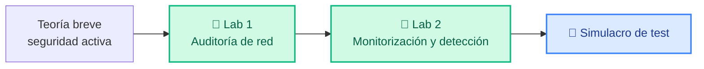

# Unidad 2 · Seguridad activa: auditoría y detección

| | |
|---|---|
| **Resultado de aprendizaje** | RA2 · Implanta mecanismos de seguridad activa |
| **Trimestre** | 1.º — se evalúa con **examen tipo test** |
| **Duración** | 16 horas |
| **Herramientas** | Python 3 · `scapy` · Docker Compose |

Esta unidad trata de **defender un sistema en marcha**: entender cómo se audita una red (qué equipos y servicios hay, si son vulnerables) y cómo se **detecta** un ataque leyendo lo que deja en los registros. Lo harás con **dos laboratorios** cortos y guiados paso a paso: primero te pones del lado del **auditor** (descubres y escaneas), y luego del lado del **defensor** (detectas en los logs lo que el auditor hizo). Son las dos caras de la misma moneda.

La evaluación es un **examen tipo test**; al final tienes un simulacro con el mismo formato.

## Cómo está organizada



## Preparación del entorno

Necesitas **Python 3** y **Docker** (con Docker Compose). Comprueba que están:

```bash
python --version          # 3.10 o superior
docker --version
docker compose version
```

Los dos laboratorios traen todos sus ficheros en las carpetas `labs/lab1/` y `labs/lab2/` del repositorio. Para el código Python que ejecutes fuera de Docker, crea un entorno virtual con una sola dependencia:

```text title="requirements.txt"
scapy==2.5.0
```

```bash
python -m venv .venv
source .venv/bin/activate      # Windows: .venv\Scripts\activate
pip install -r requirements.txt
```

!!! info "Solo una dependencia externa"
    En esta unidad lo único que se instala con `pip` es **scapy** (para el mini-IDS del Lab 2). Todo lo demás — sockets, expresiones regulares, conteo, ficheros — es de la **biblioteca estándar** de Python, que ya viene incluida.

!!! danger "Norma de uso"
    Todo esto se practica **solo** dentro de los contenedores del laboratorio o en tu propia máquina. Escanear o auditar equipos ajenos sin permiso es delito. Ver [Uso ético y legal](../recursos/uso-etico.md).

## Teoría breve: seguridad activa

La **seguridad activa** son las medidas que **previenen o detienen** un incidente *mientras el sistema funciona* (un firewall que corta una conexión, un antivirus que bloquea un fichero, un sistema que detecta un ataque). Se distingue de la **seguridad pasiva**, que **reduce el daño una vez ocurrido** (copias de seguridad, redundancia, un SAI).

| | Seguridad activa | Seguridad pasiva |
|---|---|---|
| Cuándo actúa | **Antes y durante** el incidente | **Después** del incidente |
| Ejemplos | Firewall, antivirus, IDS/IPS | Copias de seguridad, redundancia, SAI |

Tres conceptos que conviene no confundir:

- **Amenaza:** lo que podría causar daño (un atacante, un malware). No la controlas.
- **Vulnerabilidad:** la debilidad que la amenaza aprovecha (un servicio sin actualizar). **Sí** la controlas.
- **Riesgo:** la probabilidad de que una amenaza explote una vulnerabilidad, por su impacto.

Y los mecanismos de defensa que aparecen en los laboratorios:

| Mecanismo | Qué hace |
|---|---|
| **Escáner / auditoría** | Descubre qué equipos y servicios hay, y si son vulnerables (Lab 1) |
| **IDS** (*Intrusion Detection System*) | **Detecta** actividad sospechosa en los registros y **avisa** (Lab 2) |
| **IPS** | Detecta **y además bloquea** el ataque |
| **NVD** (*National Vulnerability Database*) | Base pública de vulnerabilidades conocidas (los **CVE**) |

Dos diferencias que caen en el test: un **IDS** solo avisa, un **IPS** avisa y bloquea; y un **CVE** es el identificador público de una vulnerabilidad concreta (por ejemplo, `CVE-2021-23017`).
## 🧪 Lab 1 · Auditoría de la red del laboratorio

**Objetivo.** Ponerte del lado del **auditor**: descubrir qué servicios tiene abiertos un servidor, averiguar su versión (**banner grabbing**) y cruzarla con una base de vulnerabilidades (la **NVD**) para generar un **informe de auditoría automático**.

**Qué monta el laboratorio.** Dos contenedores en la misma red: un **servidor** (nginx con una versión concreta) y el **auditor** (tu script), que lo escanea.

!!! tip "Ficheros del laboratorio"
    Están en `labs/lab1/`: `auditor.py`, `Dockerfile` y `compose.yaml`. No tienes que copiar nada.

### Paso 1 · Mira el objetivo y el auditor

El `compose.yaml` define el servidor a auditar y el auditor:

```yaml title="labs/lab1/compose.yaml"
services:
  # Objetivo de la auditoría: un servidor web con una versión concreta de nginx
  servidor:
    image: nginx:1.18.0
    networks:
      - laboratorio

  # El auditor escanea al servidor por su nombre de red
  auditor:
    build: .
    depends_on:
      - servidor
    networks:
      - laboratorio
    security_opt:
      - no-new-privileges:true

networks:
  laboratorio:
```

### Paso 2 · Entiende el auditor

El auditor hace tres cosas: **escanear** puertos, **leer el banner** (la versión que anuncia el servicio) y **cruzarlo** con la NVD.

```python title="labs/lab1/auditor.py"
import socket
import json

OBJETIVO = "servidor"          # nombre del contenedor objetivo en la red Docker
PUERTOS = [22, 23, 80, 443, 3306, 8080]

# "NVD local": versiones vulnerables conocidas (extracto, para el laboratorio)
NVD_LOCAL = {
    "nginx/1.18.0": "CVE-2021-23017 (resolver, gravedad alta)",
    "Apache/2.4.49": "CVE-2021-41773 (path traversal, crítico)",
    "OpenSSH_7.4": "CVE-2018-15473 (enumeración de usuarios)",
    "vsftpd/2.3.4": "CVE-2011-2523 (puerta trasera, crítico)",
}

def escanear(host, puerto):
    """Devuelve (abierto, banner) para un puerto."""
    s = socket.socket(socket.AF_INET, socket.SOCK_STREAM)
    s.settimeout(1.0)
    try:
        if s.connect_ex((host, puerto)) != 0:
            return False, ""
        # Banner grabbing: pedimos algo y leemos lo que el servicio anuncia
        try:
            s.send(b"GET / HTTP/1.0\r\n\r\n")
            respuesta = s.recv(2048).decode(errors="ignore")
        except Exception:
            respuesta = ""
        banner = ""
        for linea in respuesta.splitlines():
            if linea.lower().startswith("server:"):
                banner = linea.split(":", 1)[1].strip()
        return True, banner
    finally:
        s.close()

def auditar():
    hallazgos = []
    print(f"Auditando {OBJETIVO}...\n")
    for puerto in PUERTOS:
        abierto, banner = escanear(OBJETIVO, puerto)
        if abierto:
            cve = NVD_LOCAL.get(banner, "")
            estado = f"VULNERABLE: {cve}" if cve else "sin vulnerabilidades conocidas"
            print(f"  [ABIERTO] puerto {puerto:5}  {banner or '(sin banner)':20}  {estado}")
            hallazgos.append({"puerto": puerto, "banner": banner, "vulnerabilidad": cve})
    with open("informe_auditoria.json", "w", encoding="utf-8") as f:
        json.dump(hallazgos, f, indent=2, ensure_ascii=False)
    vulnerables = [h for h in hallazgos if h["vulnerabilidad"]]
    print(f"\nResumen: {len(hallazgos)} servicios abiertos, {len(vulnerables)} vulnerables.")
    print("Informe guardado en informe_auditoria.json")

if __name__ == "__main__":
    auditar()
```

- **`connect_ex`** devuelve `0` si el puerto está abierto (sin lanzar error).
- **Banner grabbing**: al pedir `GET / HTTP/1.0`, el servidor responde con una cabecera `Server:` que delata su versión exacta.
- **Cruce con la NVD**: si esa versión está en la base de vulnerabilidades, se marca con su **CVE**.

### Paso 3 · Levanta y ejecuta

```bash title="Terminal (dentro de labs/lab1/)"
docker compose build
docker compose run --rm auditor
```

**Salida esperada:**

```text
Auditando servidor...

  [ABIERTO] puerto    80  nginx/1.18.0          VULNERABLE: CVE-2021-23017 (resolver, gravedad alta)

Resumen: 1 servicios abiertos, 1 vulnerables.
Informe guardado en informe_auditoria.json
```

El auditor ha descubierto el servicio web, ha leído que es `nginx/1.18.0` y, al cruzarlo con la NVD, ha encontrado que esa versión tiene una vulnerabilidad conocida. El **informe** queda en `informe_auditoria.json`.

### Paso 4 · Apaga el laboratorio

```bash title="Terminal"
docker compose down
```

!!! success "Lo que has hecho"
    Una auditoría real en miniatura: descubrir → identificar versión → cruzar con vulnerabilidades → informe. Es exactamente lo que hacen herramientas como **nmap** + **Nessus/OpenVAS**, pero programado por ti.

> **Si te sobra tiempo:** añade a `PUERTOS` el 443 y, en el auditor, lee también la cabecera `Strict-Transport-Security` para comprobar si la web fuerza HTTPS. Es otra comprobación típica de auditoría.

## 🧪 Lab 2 · Monitorización y detección

**Objetivo.** Ahora te pones del lado del **defensor**. En el Lab 1 escaneaste y tanteaste un servidor; esas acciones **dejan rastro** en los registros. Aquí vas a **detectarlas** leyendo los logs y analizando el tráfico. Verás las **dos caras** de la misma acción.

!!! tip "Ficheros del laboratorio"
    Están en `labs/lab2/`: `auth.log`, `web.log`, `detector.py`, `generar_captura.py`, `ids_red.py`, `Dockerfile` y `compose.yaml`.

### Paso 1 · Los registros que dejó el atacante

La IP `10.0.0.66` (el auditor del Lab 1) aparece en dos registros. En `auth.log`, intentando adivinar contraseñas:

```text title="labs/lab2/auth.log"
Failed password for root from 10.0.0.66 port 51000
Failed password for root from 10.0.0.66 port 51002
Failed password for admin from 10.0.0.66 port 51004
Failed password for admin from 10.0.0.66 port 51006
Accepted password for ana from 10.0.0.5 port 60000
```

Y en `web.log`, probando rutas que no existen (buscando páginas de administración, backups…):

```text title="labs/lab2/web.log"
10.0.0.66 - GET /index.html 200
10.0.0.66 - GET /admin 404
10.0.0.66 - GET /.env 404
10.0.0.66 - GET /wp-login.php 404
10.0.0.66 - GET /backup.zip 404
10.0.0.5 - GET /index.html 200
10.0.0.5 - GET /productos 200
```

### Paso 2 · El detector de logs

Lee ambos registros, cuenta por IP y lanza una **alerta** si se supera un umbral. Es un **mini-IDS**.

```python title="labs/lab2/detector.py"
import re
from collections import Counter

UMBRAL = 3

def leer(ruta):
    with open(ruta, encoding="utf-8") as f:
        return f.read().splitlines()

# 1) auth.log: contar fallos de login por IP
fallos = Counter()
for linea in leer("auth.log"):
    m = re.search(r"Failed password for \S+ from (\d+\.\d+\.\d+\.\d+)", linea)
    if m:
        fallos[m.group(1)] += 1

# 2) web.log: contar errores 404 por IP (rastreo de rutas que no existen)
rutas_404 = Counter()
for linea in leer("web.log"):
    m = re.search(r"(\d+\.\d+\.\d+\.\d+).* 404$", linea)
    if m:
        rutas_404[m.group(1)] += 1

print("Fallos de login por IP:", dict(fallos))
print("Errores 404 por IP:    ", dict(rutas_404))

# 3) mini-IDS: una IP es sospechosa si supera el umbral en login O en rutas
print("\n--- ALERTAS ---")
hay = False
for ip in sorted(set(fallos) | set(rutas_404)):
    motivos = []
    if fallos[ip] >= UMBRAL:
        motivos.append(f"fuerza bruta ({fallos[ip]} fallos de login)")
    if rutas_404[ip] >= UMBRAL:
        motivos.append(f"rastreo de rutas ({rutas_404[ip]} rutas inexistentes)")
    if motivos:
        hay = True
        print(f"  [ALERTA] {ip}: " + " + ".join(motivos))
if not hay:
    print("  (ninguna)")
```

### Paso 3 · El mini-IDS de red (con Scapy)

El escaneo de puertos del Lab 1 también deja rastro en el **tráfico**. `generar_captura.py` recrea ese tráfico en un fichero PCAP, e `ids_red.py` lo analiza: una IP que toca **muchos puertos distintos** está escaneando.

```python title="labs/lab2/ids_red.py"
from scapy.all import rdpcap, IP, TCP

UMBRAL_PUERTOS = 5

paquetes = rdpcap("captura.pcap")

# Una IP que envía SYN a muchos puertos distintos está escaneando.
puertos_por_ip = {}
for p in paquetes:
    if p.haslayer(TCP) and p[TCP].flags == "S":
        puertos_por_ip.setdefault(p[IP].src, set()).add(p[TCP].dport)

print("--- Mini-IDS de red (escaneo de puertos) ---")
for ip, puertos in puertos_por_ip.items():
    if len(puertos) >= UMBRAL_PUERTOS:
        print(f"  [ALERTA] {ip}: escaneo de puertos ({len(puertos)} puertos distintos)")
    else:
        print(f"  {ip}: {len(puertos)} puerto(s) contactado(s), normal")
```

### Paso 4 · Levanta y ejecuta

```bash title="Terminal (dentro de labs/lab2/)"
docker compose build
docker compose run --rm analista
```

**Salida esperada:**

```text
Fallos de login por IP: {'10.0.0.66': 4}
Errores 404 por IP:     {'10.0.0.66': 4}

--- ALERTAS ---
  [ALERTA] 10.0.0.66: fuerza bruta (4 fallos de login) + rastreo de rutas (4 rutas inexistentes)

captura.pcap creada con 7 paquetes
--- Mini-IDS de red (escaneo de puertos) ---
  [ALERTA] 10.0.0.66: escaneo de puertos (6 puertos distintos)
  10.0.0.5: 1 puerto(s) contactado(s), normal
```

### Paso 5 · Apaga el laboratorio

```bash title="Terminal"
docker compose down
```

!!! success "Las dos caras de la moneda"
    La misma IP (`10.0.0.66`) que en el Lab 1 era *tu auditor*, aquí aparece como *el atacante detectado*: por fuerza bruta en `auth.log`, por rastreo de rutas en `web.log` y por escaneo de puertos en el tráfico. **Atacar y detectar son la misma acción vista desde los dos lados.**

> **Nota sobre falsos positivos.** Superar un umbral es un **patrón sospechoso que hay que verificar**, no una prueba de ataque: podría ser un script mal configurado. Un umbral muy bajo genera falsas alarmas; uno muy alto deja pasar ataques lentos.
## Actividades

> Practica con lo visto en la unidad. Usa solo lo que ya conoces: **variables**, **operadores**, condicionales **`if` / `elif` / `else`** y acceso a **diccionarios**. No necesitas escribir bucles ni definir funciones. Intenta cada una **antes** de abrir la solución.

**1 · 🟢 ¿Activa o pasiva?** Tienes `medida = "firewall"`. Escribe un `if` que imprima `"ACTIVA"` si la medida es `"firewall"`, `"antivirus"` o `"ids"`, y `"PASIVA"` en otro caso.
<details class="sol"><summary>Solución</summary>

```python
medida = "firewall"
if medida in ("firewall", "antivirus", "ids"):
    print("ACTIVA")
else:
    print("PASIVA")
```
</details>

**2 · 🟢 ¿Puerto abierto?** `connect_ex` devuelve `0` cuando un puerto está abierto. Dado `resultado = 0`, imprime `"ABIERTO"` si es 0 y `"cerrado"` en otro caso.
<details class="sol"><summary>Solución</summary>

```python
resultado = 0
if resultado == 0:
    print("ABIERTO")
else:
    print("cerrado")
```
</details>

**3 · 🟡 ¿Supera el umbral?** Tienes `fallos = 4` y `umbral = 3`. Imprime `"ALERTA"` si los fallos llegan o superan el umbral, y `"normal"` si no.
<details class="sol"><summary>Solución</summary>

```python
fallos = 4
umbral = 3
if fallos >= umbral:
    print("ALERTA")
else:
    print("normal")
```
</details>

**4 · 🟡 ¿Versión vulnerable?** Tienes un diccionario `nvd = {"nginx/1.18.0": "CVE-2021-23017"}` y una variable `banner = "nginx/1.18.0"`. Imprime el CVE si el banner está en la NVD, y `"sin vulnerabilidades conocidas"` si no.
<details class="sol"><summary>Solución</summary>

```python
nvd = {"nginx/1.18.0": "CVE-2021-23017"}
banner = "nginx/1.18.0"
if banner in nvd:
    print(nvd[banner])
else:
    print("sin vulnerabilidades conocidas")
```
</details>

**5 · 🟠 Clasificar una alerta.** Tienes `tipo = "404"` (el código de una petición web). Imprime `"rastreo de rutas"` si es `"404"`, `"acceso normal"` si es `"200"`, y `"otro"` en cualquier otro caso.
<details class="sol"><summary>Solución</summary>

```python
tipo = "404"
if tipo == "404":
    print("rastreo de rutas")
elif tipo == "200":
    print("acceso normal")
else:
    print("otro")
```
</details>

### Ejercicios propuestos (sin solución)

Ahora tú solo, con las mismas reglas (variables, `if`, sin bucles ni funciones):

**P1 · 🟢** Dada `herramienta = "IDS"`, imprime `"solo avisa"` si es `"IDS"` y `"avisa y bloquea"` si es `"IPS"`.

**P2 · 🟡** Tienes `puertos_distintos = 6` y `umbral = 5`. Imprime `"escaneo de puertos"` si se alcanza el umbral, y `"normal"` si no.

**P3 · 🟠** Dado un diccionario `alerta = {"ip": "10.0.0.66", "motivo": "fuerza bruta"}`, imprime la IP y el motivo solo si el motivo es `"fuerza bruta"` o `"escaneo"`.

## Cómo se evalúa esta unidad (RA2)

La UT1 y la UT2 forman el **1.er trimestre**, que se evalúa con un **examen tipo test** (preguntas de opción múltiple como las del simulacro).

!!! tip "La nota, sin sorpresas"
    **Nota = (aciertos ÷ nº de preguntas) × 10.** Los fallos no restan. Se aprueba con 5.

Los laboratorios no puntúan: son tu forma de entender la materia y de llegar preparado al test.

## Simulacro de examen tipo test

> 15 preguntas de opción múltiple, **una sola respuesta correcta**. Hazlo sin mirar y corrige con las soluciones desplegables.

**1.** ¿Cuál es una medida de seguridad **activa**?

- A) Una copia de seguridad diaria
- B) Un firewall que filtra el tráfico entrante
- C) Un SAI que mantiene la corriente
- D) Un sistema de servidores redundantes

<details class="sol"><summary>Ver respuesta</summary><b>Correcta: B.</b> El firewall previene/detiene el incidente mientras ocurre (activa). Copias, SAI y redundancia reducen el daño después (pasiva).</details>

**2.** La diferencia entre un **IDS** y un **IPS** es que:

- A) El IDS es software y el IPS hardware
- B) El IDS detecta y avisa; el IPS detecta y además bloquea
- C) El IDS vigila la red y el IPS un equipo
- D) Son lo mismo

<details class="sol"><summary>Ver respuesta</summary><b>Correcta: B.</b> IDS = detección y aviso; IPS = detección + bloqueo.</details>

**3.** En análisis de riesgos, un servicio SSH **sin actualizar** con un fallo conocido es una:

- A) Amenaza
- B) Vulnerabilidad
- C) Salvaguarda
- D) Copia de seguridad

<details class="sol"><summary>Ver respuesta</summary><b>Correcta: B.</b> La vulnerabilidad es la debilidad que se puede explotar; la amenaza es quien la aprovecharía.</details>

**4.** ¿Qué es un **CVE**?

- A) Un antivirus
- B) El identificador público de una vulnerabilidad conocida
- C) Un tipo de cortafuegos
- D) Un protocolo de red

<details class="sol"><summary>Ver respuesta</summary><b>Correcta: B.</b> Un CVE (p. ej. CVE-2021-23017) identifica de forma única una vulnerabilidad registrada en la NVD.</details>

**5.** El **banner grabbing** consiste en:

- A) Borrar los registros de un servidor
- B) Leer la información (versión del servicio) que un puerto abierto anuncia
- C) Cifrar el tráfico de red
- D) Bloquear una IP

<details class="sol"><summary>Ver respuesta</summary><b>Correcta: B.</b> Al conectarse a un servicio, este suele anunciar su software y versión (p. ej. <code>Server: nginx/1.18.0</code>), lo que permite buscar sus vulnerabilidades.</details>

**6.** En el escáner, `connect_ex((host, puerto))` devuelve **0**. ¿Qué significa?

- A) El puerto está cerrado
- B) El puerto está abierto
- C) Hubo un error de red
- D) El host no existe

<details class="sol"><summary>Ver respuesta</summary><b>Correcta: B.</b> <code>connect_ex</code> devuelve <code>0</code> cuando la conexión tiene éxito, es decir, el puerto está abierto (y no lanza excepción).</details>

**7.** ¿Para qué sirve la **NVD** (National Vulnerability Database)?

- A) Para almacenar contraseñas
- B) Para consultar qué vulnerabilidades conocidas afecta a una versión de software
- C) Para cifrar ficheros
- D) Para generar tráfico de red

<details class="sol"><summary>Ver respuesta</summary><b>Correcta: B.</b> La NVD es la base pública de vulnerabilidades (CVE); cruzar la versión detectada con ella dice si el software es vulnerable.</details>

**8.** En `auth.log`, muchas líneas `Failed password` desde la misma IP indican:

- A) Un acceso correcto
- B) Un intento de fuerza bruta
- C) Una copia de seguridad
- D) Tráfico cifrado

<details class="sol"><summary>Ver respuesta</summary><b>Correcta: B.</b> Repetir intentos fallidos de login desde una IP es el patrón de la fuerza bruta.</details>

**9.** En un log web, muchos códigos **404** desde la misma IP sugieren:

- A) Que la web funciona perfectamente
- B) Un rastreo de rutas (el atacante prueba páginas que no existen)
- C) Un acceso autorizado
- D) Un error del navegador del administrador

<details class="sol"><summary>Ver respuesta</summary><b>Correcta: B.</b> Probar muchas rutas inexistentes (/admin, /.env, /backup.zip…) es típico de quien busca puntos de entrada.</details>

**10.** ¿Qué imprime este código?

```python
from collections import Counter
fallos = Counter()
for ip in ["1.1.1.1", "1.1.1.1", "2.2.2.2"]:
    fallos[ip] += 1
print(dict(fallos))
```

- A) `{'1.1.1.1': 1, '2.2.2.2': 1}`
- B) `{'1.1.1.1': 2, '2.2.2.2': 1}`
- C) `{'1.1.1.1': 3}`
- D) `{}`

<details class="sol"><summary>Ver respuesta</summary><b>Correcta: B.</b> <code>Counter</code> cuenta repeticiones: <code>1.1.1.1</code> aparece dos veces y <code>2.2.2.2</code> una.</details>

**11.** En el mini-IDS de red, una IP que envía SYN a **muchos puertos distintos** indica:

- A) Una descarga normal
- B) Un escaneo de puertos
- C) Una consulta DNS
- D) Un acceso HTTPS

<details class="sol"><summary>Ver respuesta</summary><b>Correcta: B.</b> Tocar muchos puertos distintos en poco tiempo es la huella del escaneo de puertos (reconocimiento).</details>

**12.** ¿Por qué el detector usa un **umbral** antes de lanzar una alerta?

- A) Para que el programa vaya más rápido
- B) Para no alertar por uno o dos intentos normales (evitar falsos positivos)
- C) Porque Python lo exige
- D) Para cifrar los logs

<details class="sol"><summary>Ver respuesta</summary><b>Correcta: B.</b> El umbral separa el ruido normal (un despiste) de un patrón de ataque, reduciendo los falsos positivos.</details>

**13.** Que una IP supere el umbral de fallos, ¿demuestra que hay un ataque?

- A) Sí, es una prueba definitiva
- B) No: es un patrón sospechoso que hay que verificar
- C) Sí, hay que bloquearla sin comprobar nada
- D) No significa nada

<details class="sol"><summary>Ver respuesta</summary><b>Correcta: B.</b> Un umbral superado señala para investigar; podría ser también un script mal configurado o credenciales caducadas.</details>

**14.** En el laboratorio, la IP `10.0.0.66` aparece como auditor (Lab 1) y como atacante detectado (Lab 2). ¿Qué ilustra esto?

- A) Que hay dos atacantes distintos
- B) Que atacar y detectar son la misma acción vista desde los dos lados
- C) Que el laboratorio tiene un error
- D) Que la IP cambió de dueño

<details class="sol"><summary>Ver respuesta</summary><b>Correcta: B.</b> Lo que el auditor hace (escanear, tantear logins, probar rutas) es justo lo que el defensor detecta en los registros.</details>

**15.** ¿Qué diferencia a un **IDS** de un **firewall**?

- A) El firewall detecta y el IDS bloquea
- B) El firewall filtra el tráfico según reglas; el IDS observa y avisa de actividad sospechosa
- C) Son lo mismo
- D) El IDS solo funciona en Windows

<details class="sol"><summary>Ver respuesta</summary><b>Correcta: B.</b> El firewall decide qué pasa (prevención); el IDS vigila lo que ocurre y avisa (detección).</details>
