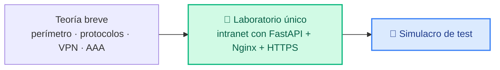
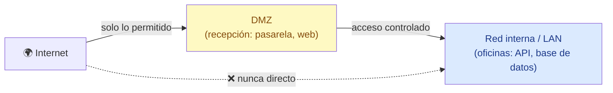
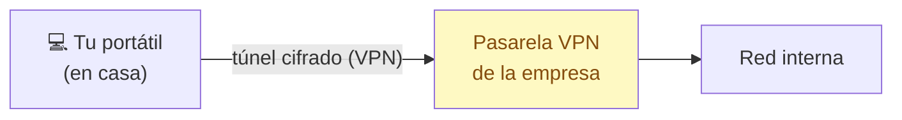
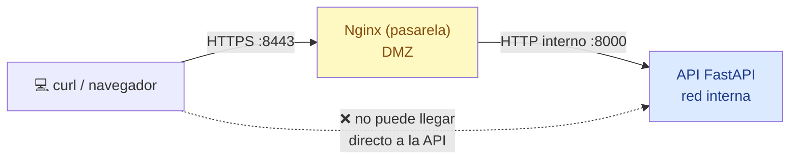

# Unidad 3 · Seguridad perimetral y acceso remoto

| | |
|---|---|
| **Resultado de aprendizaje** | RA3 · Implanta seguridad perimetral y acceso remoto |
| **Trimestre** | 2.º |
| **Duración** | 14 horas |
| **Herramientas** | Docker Compose · FastAPI · Nginx · `curl` · Python |

El **perímetro** de una red es su frontera con el exterior. Esta unidad trata de cómo se protege esa frontera (cortafuegos, DMZ, segmentación) y de cómo se permite el **acceso remoto seguro** (protocolos cifrados, pasarelas, VPN). La teoría es breve y va directa a la práctica: construirás **un único laboratorio** que monta la intranet de una empresa pequeña, con una API privada detrás de una pasarela, y comprobarás tú mismo por qué está protegida.

!!! info "Esta unidad se evalúa con test"
    El laboratorio es la forma de **entender** los conceptos montándolos. La calificación es un **examen tipo test**; al final tienes un simulacro.



## Parte 1 · Teoría

### 1.1 Seguridad perimetral: Internet, red interna y DMZ

Imagina una empresa como un edificio. **Internet** es la calle; la **red interna (LAN)** son las oficinas privadas donde está lo valioso (bases de datos, ficheros); y la **DMZ** (*zona desmilitarizada*) es como la **recepción**: una zona intermedia donde se atiende al público sin dejarle entrar en las oficinas.



La regla de oro: **desde Internet nunca se llega directamente a la red interna**. Lo que da la cara (una web, una pasarela) vive en la DMZ; si alguien la compromete, todavía tiene otra barrera antes de llegar a lo importante.

- **Cortafuegos (firewall):** el portero que decide qué tráfico pasa, según reglas.
- **Segmentación de redes:** dividir la red en zonas aisladas, de modo que un problema en una no contamine las demás. Es lo que harás con las dos redes Docker del laboratorio.

### 1.2 Protocolos seguros: HTTP/HTTPS, TLS y SSH

| Protocolo | Para qué | ¿Cifrado? |
|---|---|---|
| **HTTP** | Navegación web | ❌ No: todo viaja en claro |
| **HTTPS** | Navegación web segura | ✅ Sí, con **TLS** |
| **SSH** | Administración remota de un servidor (terminal) | ✅ Sí |

**HTTPS** no es un protocolo nuevo: es **HTTP sobre TLS**. **TLS** (*Transport Layer Security*) es la capa que cifra la comunicación y, mediante un **certificado**, garantiza que hablas con quien crees (recuerda los certificados de la UT1). Por eso el candado del navegador significa "cifrado + identidad verificada".

**SSH** (*Secure Shell*) permite abrir una terminal en un servidor remoto de forma cifrada. Sustituyó a Telnet, que enviaba las contraseñas en claro. Un comando típico:

```bash
ssh usuario@servidor        # abre una sesión remota cifrada
```

### 1.3 VPN: una red privada sobre una pública

Una **VPN** (*Virtual Private Network*) crea un **túnel cifrado** entre tu equipo y la red de la empresa a través de Internet. Es como tener un cable privado hasta la oficina, aunque estés en casa: todo lo que viaja por el túnel va cifrado y, para la red de la empresa, es como si estuvieras dentro.



Elementos de una VPN: el **túnel** (el canal cifrado), las **claves** (para cifrar y autenticar los extremos) y las **rutas** (qué tráfico va por el túnel y cuál no). Ejemplos reales: WireGuard, OpenVPN, IPsec.

### 1.4 Acceso remoto: pasarelas, autenticación, autorización y control de acceso

Cuando alguien accede desde fuera, el acceso pasa por una **pasarela** (*gateway*): un único punto de entrada que concentra los controles. En el laboratorio, esa pasarela será **Nginx**. Sobre ella se aplican las **tres A (AAA)**:

| | Pregunta | En el laboratorio |
|---|---|---|
| **Autenticación** | ¿Quién eres? | La cabecera `X-Token` de la API |
| **Autorización** | ¿Qué puedes hacer? | Sin token válido → `401` (denegado) |
| **Auditoría** (*accounting*) | ¿Qué hiciste y cuándo? | Los registros de Nginx y de la API |

### 1.5 Autenticación centralizada: RADIUS

En una empresa con muchos usuarios y servicios, no tiene sentido que cada servicio tenga su propia lista de contraseñas. **RADIUS** es un protocolo que **centraliza** la autenticación: los servicios preguntan a un servidor RADIUS "¿este usuario y contraseña son válidos?", y él responde. Así hay **una sola** fuente de identidades (altas, bajas y cambios en un único sitio). Se usa mucho en wifi corporativas y VPN. No lo montaremos, pero debes reconocer **qué problema resuelve**: evitar tener las credenciales repartidas por todos lados.

!!! note "Lo esencial de la teoría para el test"
    DMZ = zona intermedia; Internet nunca llega directo a la LAN. HTTPS = HTTP + TLS (cifrado + identidad). SSH = terminal remota cifrada (sustituye a Telnet). VPN = túnel cifrado (túnel + claves + rutas). Pasarela = punto único de entrada. AAA = autenticación/autorización/auditoría. RADIUS = autenticación centralizada.
## Parte 2 · Laboratorio: acceso seguro a una intranet

Vas a montar la intranet de una empresa pequeña: una **API privada** (FastAPI) con datos de empleados, protegida detrás de una **pasarela Nginx** con **HTTPS**. La API **nunca** se expone directamente a Internet: solo se llega a ella a través de la pasarela. Comprobarás el aislamiento, los códigos HTTP y el cifrado, y automatizarás las pruebas con Python.



!!! tip "Ficheros listos para usar"
    Todo el laboratorio está en la carpeta **`lab/`** del repositorio del curso, con esta estructura. No tienes que copiar nada a mano:

    ```text
    lab/
    ├── compose.yaml              # define servicios y redes
    ├── generar_certificado.sh    # crea el certificado de laboratorio
    ├── pruebas.py                # pruebas de conectividad en Python
    ├── requirements-pruebas.txt
    ├── api/                      # la API privada (FastAPI)
    │   ├── app.py
    │   ├── Dockerfile
    │   └── requirements.txt
    └── nginx/                    # la pasarela
        ├── nginx.conf
        └── Dockerfile
    ```

### Paso 1 · Los servicios y las redes (Docker Compose)

El `compose.yaml` define **dos servicios** y, sobre todo, **dos redes**, que es donde está la seguridad:

```yaml title="lab/compose.yaml"
services:
  # Pasarela: única cara visible. Está en la DMZ (publicada) y en la red interna.
  nginx:
    build: ./nginx
    ports:
      - "8080:80"      # HTTP del host -> redirige a HTTPS
      - "8443:443"     # HTTPS del host -> pasarela
    volumes:
      - ./nginx/certs:/etc/nginx/certs:ro
    networks:
      - dmz
      - interna
    depends_on:
      - api
    security_opt:
      - no-new-privileges:true

  # API: SOLO en la red interna. No tiene 'ports', así que el host no la ve.
  api:
    build: ./api
    networks:
      - interna
    security_opt:
      - no-new-privileges:true

networks:
  dmz:
  interna:
    internal: true     # esta red no tiene salida a internet: aislamiento
```

**Lo importante:** la API **no tiene `ports`**. Eso significa que desde tu ordenador (el host) **no existe** una forma de llamarla directamente: solo es alcanzable desde dentro de la red `interna`, donde también está Nginx. La pasarela es el único puente.

### Paso 2 · La API con FastAPI

**FastAPI** es un framework de Python para crear APIs web rápidamente. La nuestra tiene tres *endpoints* y exige un **token** para los datos sensibles:

```python title="lab/api/app.py"
from fastapi import FastAPI, HTTPException, Header

app = FastAPI(title="Intranet API")

EMPLEADOS = {
    1: {"nombre": "Ana García", "departamento": "Sistemas"},
    2: {"nombre": "Luis Pérez", "departamento": "Ventas"},
}
TOKEN_VALIDO = "secreto-de-laboratorio"

@app.get("/salud")
def salud():
    """Comprobación de vida del servicio (no requiere token)."""
    return {"estado": "ok"}

@app.get("/empleados")
def listar(x_token: str = Header(default="")):
    """Lista los empleados. Requiere cabecera X-Token válida."""
    if x_token != TOKEN_VALIDO:
        raise HTTPException(status_code=401, detail="token no válido")
    return list(EMPLEADOS.values())

@app.get("/empleados/{id}")
def obtener(id: int, x_token: str = Header(default="")):
    """Devuelve un empleado por su id. Requiere token válido."""
    if x_token != TOKEN_VALIDO:
        raise HTTPException(status_code=401, detail="token no válido")
    if id not in EMPLEADOS:
        raise HTTPException(status_code=404, detail="no existe")
    return EMPLEADOS[id]
```

- `/salud` es público: sirve para comprobar que el servicio vive.
- `/empleados` y `/empleados/{id}` exigen la cabecera `X-Token`. Sin ella, devuelven **401** (no autorizado): esto es la **autenticación** de las AAA.

### Paso 3 · Generar el certificado de laboratorio

HTTPS necesita un certificado. Como es un laboratorio, creamos uno **autofirmado** (válido para pruebas, no para producción). El script usa `openssl`:

```bash title="lab/generar_certificado.sh"
#!/bin/sh
mkdir -p nginx/certs
openssl req -x509 -newkey rsa:2048 -nodes \
    -keyout nginx/certs/key.pem \
    -out nginx/certs/cert.pem \
    -days 365 \
    -subj "/CN=intranet.local"
echo "Certificado creado en nginx/certs/"
```

Ejecútalo una vez antes de levantar los contenedores:

```bash title="Terminal (dentro de lab/)"
sh generar_certificado.sh
```

### Paso 4 · Nginx como pasarela (sin exponer la API)

Nginx recibe las peticiones de fuera y las **reenvía** a la API por la red interna. Además, obliga a usar HTTPS: si alguien entra por HTTP (puerto 80), lo redirige a HTTPS (443).

```nginx title="lab/nginx/nginx.conf"
events {}

http {
    # Redirige todo el tráfico HTTP (80) a HTTPS (443)
    server {
        listen 80;
        return 301 https://$host$request_uri;
    }

    # Punto de entrada seguro
    server {
        listen 443 ssl;
        server_name intranet.local;

        ssl_certificate     /etc/nginx/certs/cert.pem;
        ssl_certificate_key /etc/nginx/certs/key.pem;

        # Reenvía las peticiones a la API, que vive en la red interna
        location / {
            proxy_pass http://api:8000;
            proxy_set_header Host $host;
        }
    }
}
```

Fíjate en `proxy_pass http://api:8000`: Nginx llama a la API por su **nombre de servicio** (`api`), que solo se resuelve **dentro** de la red Docker. El `301` de la primera sección es una **redirección permanente** a HTTPS.

**Levanta todo el laboratorio:**

```bash title="Terminal (dentro de lab/)"
docker compose up --build -d
```

### Paso 5 · Probar los endpoints con `curl` y ver los códigos HTTP

Ahora comprueba el comportamiento desde fuera. La opción `-k` le dice a `curl` que acepte el certificado autofirmado (solo en laboratorio); `-i` muestra la cabecera con el código HTTP.

```bash title="Terminal"
# 1) Salud del servicio (público) -> 200 OK
curl -k https://localhost:8443/salud

# 2) Listar empleados SIN token -> 401 (no autorizado)
curl -k -i https://localhost:8443/empleados

# 3) Listar empleados CON token -> 200 OK
curl -k -H "X-Token: secreto-de-laboratorio" https://localhost:8443/empleados

# 4) Un empleado que no existe -> 404
curl -k -H "X-Token: secreto-de-laboratorio" https://localhost:8443/empleados/99

# 5) Entrar por HTTP -> 301 (redirige a HTTPS)
curl -i http://localhost:8080/salud
```

| Petición | Código esperado | Qué demuestra |
|---|---|---|
| `/salud` | `200` | El servicio funciona |
| `/empleados` sin token | `401` | La autenticación protege los datos |
| `/empleados` con token | `200` | Con credencial válida, hay acceso |
| `/empleados/99` | `404` | El recurso no existe |
| `http://...` (puerto 80) | `301` | Se fuerza el uso de HTTPS |

### Paso 6 · Comprobar el aislamiento entre redes

Aquí se ve por qué la arquitectura es segura. Intenta llamar a la API **directamente**, saltándote la pasarela:

```bash title="Terminal"
# La API escucha en el 8000, pero DENTRO de la red interna.
# Desde el host no hay ningún puerto publicado hacia ella:
curl http://localhost:8000/salud
```

```text title="Resultado"
curl: (7) Failed to connect to localhost port 8000: Connection refused
```

**No se puede.** La API no tiene ningún puerto publicado hacia el host: solo Nginx puede hablar con ella, porque comparten la red `interna`. Puedes confirmar que Nginx **sí** la alcanza desde dentro:

```bash title="Terminal"
docker compose exec nginx wget -qO- http://api:8000/salud
```

```text title="Resultado"
{"estado":"ok"}
```

Esto es la **segmentación de redes** en acción: la API está en una zona aislada (`internal: true`, sin salida a Internet) y solo la pasarela, que hace de puente controlado, puede llegar a ella.

### Paso 7 · SSH y VPN: demostración de acceso remoto

La pasarela web protege el acceso a la *aplicación*. Para administrar el *servidor* se usa **SSH**, y para meter todo tu equipo *dentro* de la red de la empresa, una **VPN**.

**SSH** (demostración conceptual): conectarte a un servidor sería tan simple como:

```bash title="Terminal (ejemplo)"
ssh admin@servidor-intranet       # terminal remota cifrada
```

Todo lo que escribes y recibes va cifrado. Nadie que capture el tráfico (recuerda Scapy, UT2) puede leer tu contraseña ni tus comandos, al contrario que con el antiguo Telnet.

**VPN** (idea): si levantaras un servidor WireGuard en la DMZ, tu portátil establecería un túnel cifrado y entraría en la red `interna` como si estuviera físicamente en la oficina — entonces **sí** podrías llamar a `http://api:8000` directamente, porque estarías *dentro*. La VPN te convierte en un miembro más de la red interna, de forma segura.

### Paso 8 · Automatizar las pruebas con Python

Hacer las pruebas a mano con `curl` está bien para aprender, pero en la práctica se **automatizan**. Este script repite todas las comprobaciones y genera un informe:

```python title="lab/pruebas.py"
import json
import requests

# Atacamos SIEMPRE a la pasarela (Nginx), nunca a la API directamente.
BASE = "https://localhost:8443"
TOKEN = {"X-Token": "secreto-de-laboratorio"}

# Certificado autofirmado de laboratorio: por eso verify=False (solo en pruebas).
requests.packages.urllib3.disable_warnings()

PRUEBAS = [
    ("Salud del servicio (sin token)",         lambda: requests.get(f"{BASE}/salud", verify=False),                 200),
    ("Listar empleados SIN token (denegado)",  lambda: requests.get(f"{BASE}/empleados", verify=False),             401),
    ("Listar empleados CON token",             lambda: requests.get(f"{BASE}/empleados", headers=TOKEN, verify=False), 200),
    ("Empleado existente CON token",           lambda: requests.get(f"{BASE}/empleados/1", headers=TOKEN, verify=False), 200),
    ("Empleado inexistente CON token (404)",   lambda: requests.get(f"{BASE}/empleados/99", headers=TOKEN, verify=False), 404),
]

def ejecutar() -> list[dict]:
    resultados = []
    for descripcion, llamada, esperado in PRUEBAS:
        try:
            codigo = llamada().status_code
        except requests.RequestException:
            codigo = None
        resultados.append({
            "prueba": descripcion,
            "esperado": esperado,
            "obtenido": codigo,
            "resultado": "OK" if codigo == esperado else "FALLO",
        })
    return resultados

if __name__ == "__main__":
    resultados = ejecutar()
    print(f"{'PRUEBA':42} {'ESPERA':7} {'OBTIENE':8} RESULTADO")
    print("-" * 70)
    for r in resultados:
        print(f"{r['prueba']:42} {r['esperado']:<7} {str(r['obtenido']):<8} {r['resultado']}")
    aciertos = sum(1 for r in resultados if r["resultado"] == "OK")
    print("-" * 70)
    print(f"Total: {aciertos}/{len(resultados)} pruebas correctas")
    with open("informe.json", "w", encoding="utf-8") as f:
        json.dump(resultados, f, indent=2, ensure_ascii=False)
    print("Informe guardado en informe.json")
```

Ejecútalo (con el laboratorio levantado):

```bash title="Terminal (dentro de lab/)"
pip install -r requirements-pruebas.txt
python pruebas.py
```

```text title="Salida esperada"
PRUEBA                                     ESPERA  OBTIENE  RESULTADO
----------------------------------------------------------------------
Salud del servicio (sin token)             200     200      OK
Listar empleados SIN token (denegado)      401     401      OK
Listar empleados CON token                 200     200      OK
Empleado existente CON token               200     200      OK
Empleado inexistente CON token (404)       404     404      OK
----------------------------------------------------------------------
Total: 5/5 pruebas correctas
Informe guardado en informe.json
```

**Al terminar, apaga el laboratorio:**

```bash title="Terminal (dentro de lab/)"
docker compose down
```

!!! success "🏅 Laboratorio completado"
    Has montado una intranet con separación de zonas (DMZ/interna), una pasarela que obliga a HTTPS, una API privada que nadie alcanza directamente, y pruebas automatizadas que lo demuestran. Eso es seguridad perimetral real.

**Errores habituales.**

| Síntoma | Causa | Solución |
|---|---|---|
| `curl` da error de certificado | Certificado autofirmado | Usa `-k` (solo en laboratorio) |
| La API responde en `localhost:8000` | Publicaste su puerto por error | La API **no** debe tener `ports` en el compose |
| `502 Bad Gateway` en Nginx | La API aún no había arrancado | Espera unos segundos o revisa `depends_on` |
| `pruebas.py` falla al conectar | El laboratorio no está levantado | `docker compose up --build -d` primero |
### 🔍 Comprueba tú mismo

Has montado el laboratorio siguiendo los pasos. Ahora toca **entenderlo de verdad** experimentando y respondiendo. Intenta contestar antes de abrir cada solución.

**Experimento 1 · El aislamiento.** Con el laboratorio levantado, intenta llamar a la API saltándote la pasarela, directamente por su puerto interno:

```bash
curl http://localhost:8000/salud
```

- **P1.** ¿Qué ocurre? ¿Por qué, si la API escucha en el 8000, no puedes llegar a ella desde tu máquina?

<details class="sol"><summary>Respuesta</summary>Da <code>Connection refused</code>. La API <b>no publica ningún puerto</b> hacia el host (no tiene <code>ports</code> en el compose): solo es alcanzable desde dentro de la red <code>interna</code>, donde también está Nginx. Es el aislamiento de redes funcionando: desde Internet nunca se llega directo a la red interna.</details>

**Experimento 2 · Los códigos HTTP.** Lanza estas tres peticiones y anota el código que devuelve cada una:

```bash
curl -k -o /dev/null -s -w "%{http_code}\n" https://localhost:8443/empleados
curl -k -o /dev/null -s -w "%{http_code}\n" -H "X-Token: secreto-de-laboratorio" https://localhost:8443/empleados
curl -k -o /dev/null -s -w "%{http_code}\n" -H "X-Token: secreto-de-laboratorio" https://localhost:8443/empleados/99
```

- **P2.** ¿Qué código da cada una y qué significa?

<details class="sol"><summary>Respuesta</summary>La primera da <b>401</b> (no autorizado: falta el token). La segunda, <b>200</b> (con token válido, acceso correcto). La tercera, <b>404</b> (el empleado 99 no existe). El 401 es la autenticación protegiendo los datos; el 404 es un recurso inexistente.</details>

**Experimento 3 · Forzar HTTPS.** Entra por HTTP (puerto 80) en vez de HTTPS:

```bash
curl -i http://localhost:8080/salud
```

- **P3.** ¿Qué código HTTP devuelve y qué hace Nginx con tu petición?

<details class="sol"><summary>Respuesta</summary>Devuelve <b>301</b> (redirección permanente): Nginx está configurado para redirigir todo el tráfico HTTP a HTTPS. Así se fuerza que la comunicación siempre vaya cifrada.</details>

**Experimento 4 · El certificado.** Repite una petición HTTPS **sin** la opción `-k`:

```bash
curl https://localhost:8443/salud
```

- **P4.** ¿Qué error da `curl`? ¿Por qué, y por qué en el laboratorio usamos `-k`?

<details class="sol"><summary>Respuesta</summary>Da un error de certificado no confiable. El certificado es <b>autofirmado</b>: cifra igual, pero ninguna Autoridad de Certificación (CA) lo avala, así que <code>curl</code> desconfía por defecto. Con <code>-k</code> le decimos que lo acepte (solo válido en laboratorio; en producción se usa un certificado emitido por una CA).</details>

**Experimento 5 · La pasarela desde dentro.** Comprueba que Nginx **sí** alcanza la API por su nombre de servicio:

```bash
docker compose exec nginx wget -qO- http://api:8000/salud
```

- **P5.** ¿Funciona? ¿Por qué Nginx puede llamar a `api:8000` y tú no?

<details class="sol"><summary>Respuesta</summary>Sí, devuelve <code>{"estado":"ok"}</code>. Nginx comparte la red <code>interna</code> con la API, y Docker resuelve el nombre <code>api</code> dentro de esa red. Tú, desde el host, estás fuera de esa red, así que ese nombre no existe para ti. Es exactamente lo que hace segura la arquitectura: la pasarela es el único puente.</details>

**Para pensar (sin comando).**

- **P6.** Si levantaras una VPN hacia la red `interna` y te conectaras a ella, ¿podrías entonces llamar a `http://api:8000` directamente? ¿Por qué?

<details class="sol"><summary>Respuesta</summary>Sí. La VPN te metería <i>dentro</i> de la red interna mediante un túnel cifrado: para la red, serías un miembro más, así que alcanzarías la API directamente. Esa es justo la función de una VPN para el teletrabajo.</details>

!!! tip "➡️ Todo esto cae en el test"
    Cada pregunta de arriba corresponde a una del simulacro: el aislamiento (P1, P5), los códigos HTTP 401/404/301 (P2, P3), el certificado autofirmado y el `-k` (P4), y la VPN (P6). Si has hecho los experimentos y entiendes las respuestas, el test de esta unidad lo tienes dominado.

## Parte 3 · Resumen y evaluación

### Resumen para el examen

| Tema | Idea clave |
|---|---|
| DMZ | Zona intermedia (recepción); Internet nunca llega directo a la LAN |
| Cortafuegos | Filtra el tráfico según reglas |
| Segmentación | Dividir la red en zonas aisladas (las dos redes Docker) |
| HTTP / HTTPS | HTTPS = HTTP + TLS (cifrado + identidad por certificado) |
| SSH | Terminal remota cifrada; sustituye a Telnet |
| VPN | Túnel cifrado sobre Internet; túnel + claves + rutas |
| Pasarela (gateway) | Punto único de entrada donde se concentran los controles (Nginx) |
| AAA | Autenticación (¿quién?) · Autorización (¿qué puede?) · Auditoría (¿qué hizo?) |
| RADIUS | Autenticación centralizada: una sola fuente de identidades |
| Códigos HTTP | 200 OK · 301 redirección · 401 no autorizado · 404 no encontrado |

### Cómo se evalúa esta unidad

La UT3 se evalúa con un **examen tipo test** de opción múltiple, una sola respuesta correcta.

!!! tip "La nota, sin sorpresas"
    **Nota = (aciertos ÷ nº de preguntas) × 10.** Los fallos no restan. Se aprueba con 5.

El laboratorio no puntúa directamente, pero montarlo es la mejor preparación: casi todas las preguntas salen de lo que has visto construyéndolo.

## Simulacro de examen tipo test

> 20 preguntas de opción múltiple sobre la unidad. Una sola respuesta correcta. Hazlo sin mirar y corrige al final.

**1.** ¿Qué es una **DMZ** en seguridad perimetral?

A) La red más interna, donde está la base de datos
B) Una zona intermedia entre Internet y la red interna, donde se colocan los servicios públicos
C) Un tipo de cortafuegos
D) Una VPN

<details class="sol"><summary>Ver respuesta</summary><b>Correcta: B.</b> La DMZ es la "recepción": aloja lo que debe ser accesible desde fuera, sin dar acceso directo a la red interna.</details>

**2.** La regla de oro de la seguridad perimetral es:

A) Desde Internet nunca se llega directamente a la red interna
B) Todo el tráfico debe ir por HTTP
C) La base de datos debe estar en la DMZ
D) No usar cortafuegos

<details class="sol"><summary>Ver respuesta</summary><b>Correcta: A.</b> Entre Internet y lo valioso siempre hay al menos una barrera (la DMZ y la pasarela).</details>

**3.** ¿Qué relación hay entre **HTTPS** y **TLS**?

A) Son lo mismo
B) HTTPS es HTTP sobre TLS: TLS aporta el cifrado y la identidad
C) TLS es una versión antigua de HTTPS
D) No tienen relación

<details class="sol"><summary>Ver respuesta</summary><b>Correcta: B.</b> HTTPS = HTTP + TLS. TLS cifra la comunicación y, con el certificado, verifica la identidad del servidor.</details>

**4.** ¿Para qué sirve **SSH**?

A) Para navegar por webs cifradas
B) Para abrir una terminal remota cifrada en un servidor
C) Para almacenar contraseñas
D) Para filtrar tráfico de red

<details class="sol"><summary>Ver respuesta</summary><b>Correcta: B.</b> SSH da acceso de administración remota cifrado; sustituyó a Telnet, que iba en claro.</details>

**5.** ¿Qué define mejor una **VPN**?

A) Un antivirus de red
B) Un túnel cifrado que conecta tu equipo con la red de la empresa a través de Internet
C) Un servidor web
D) Un tipo de certificado

<details class="sol"><summary>Ver respuesta</summary><b>Correcta: B.</b> La VPN crea un túnel cifrado: para la red de la empresa, es como si estuvieras dentro.</details>

**6.** Los tres elementos característicos de una VPN son:

A) Usuario, contraseña y correo
B) Túnel, claves y rutas
C) HTTP, HTTPS y FTP
D) CPU, memoria y disco

<details class="sol"><summary>Ver respuesta</summary><b>Correcta: B.</b> El túnel (canal cifrado), las claves (cifrado/autenticación) y las rutas (qué tráfico va por el túnel).</details>

**7.** Una **pasarela** (gateway) en el acceso remoto es:

A) Un punto único de entrada donde se concentran los controles de seguridad
B) Una copia de seguridad
C) Un antivirus
D) Un disco de red

<details class="sol"><summary>Ver respuesta</summary><b>Correcta: A.</b> Concentra autenticación, cifrado y registro en un solo sitio. En el laboratorio, es Nginx.</details>

**8.** En las **AAA**, la **autorización** responde a:

A) ¿Quién eres?
B) ¿Qué puedes hacer?
C) ¿Qué hiciste y cuándo?
D) ¿Desde dónde te conectas?

<details class="sol"><summary>Ver respuesta</summary><b>Correcta: B.</b> Autenticación = quién eres; autorización = qué puedes hacer; auditoría = qué hiciste.</details>

**9.** ¿Qué problema resuelve **RADIUS**?

A) Cifrar el disco
B) Centralizar la autenticación en una sola fuente de identidades
C) Acelerar la red
D) Detectar virus

<details class="sol"><summary>Ver respuesta</summary><b>Correcta: B.</b> Evita tener las credenciales repartidas por cada servicio: altas, bajas y cambios en un único sitio.</details>

**10.** **Segmentar** una red consiste en:

A) Hacer copias de seguridad
B) Dividirla en zonas aisladas para que un problema no se propague
C) Aumentar su velocidad
D) Cifrar los ficheros

<details class="sol"><summary>Ver respuesta</summary><b>Correcta: B.</b> La segmentación limita el alcance de un incidente: cada zona está aislada de las demás.</details>

**11.** En el laboratorio, la API FastAPI **no tiene `ports`** en el compose. ¿Qué consigue eso?

A) Que vaya más rápida
B) Que el host no pueda llamarla directamente; solo Nginx, desde la red interna
C) Que no necesite certificado
D) Que se apague sola

<details class="sol"><summary>Ver respuesta</summary><b>Correcta: B.</b> Sin puerto publicado, la API es inalcanzable desde fuera: solo la pasarela, que comparte la red interna, llega a ella.</details>

**12.** `curl -k https://localhost:8443/empleados` devuelve **401**. ¿Qué significa?

A) El servidor no existe
B) Falta la autenticación (no se envió un token válido)
C) El recurso no existe
D) Todo correcto

<details class="sol"><summary>Ver respuesta</summary><b>Correcta: B.</b> 401 = no autorizado: la API exige la cabecera <code>X-Token</code> y no se envió o es incorrecta.</details>

**13.** En la configuración de Nginx, ¿qué hace `return 301 https://$host$request_uri;` en el servidor que escucha en el puerto 80?

A) Bloquea el acceso
B) Redirige el tráfico HTTP a HTTPS
C) Devuelve un error
D) Cifra la contraseña

<details class="sol"><summary>Ver respuesta</summary><b>Correcta: B.</b> Fuerza el uso de HTTPS: quien entra por HTTP es redirigido (301) a la versión segura.</details>

**14.** `proxy_pass http://api:8000;` funciona porque:

A) `api` es una IP pública
B) `api` es el nombre del servicio, que se resuelve dentro de la red Docker
C) El host publica el puerto 8000
D) Nginx adivina la dirección

<details class="sol"><summary>Ver respuesta</summary><b>Correcta: B.</b> Docker resuelve el nombre del servicio (<code>api</code>) dentro de su red interna; por eso Nginx la encuentra y el host no.</details>

**15.** El certificado del laboratorio es **autofirmado**. Por eso en `curl` se usa `-k`. ¿Qué implica?

A) Que el cifrado no funciona
B) Que ninguna CA lo avala, así que el cliente no confía en él por defecto (válido solo para pruebas)
C) Que es más seguro que uno real
D) Que no caduca

<details class="sol"><summary>Ver respuesta</summary><b>Correcta: B.</b> Un autofirmado cifra igual, pero al no estar avalado por una CA el navegador/cliente desconfía; en producción se usa uno emitido por una CA.</details>

**16.** Intentas `curl http://localhost:8000/salud` y obtienes *Connection refused*. ¿Por qué?

A) La API está rota
B) La API no publica ningún puerto hacia el host: está aislada en la red interna
C) Falta el token
D) El certificado ha caducado

<details class="sol"><summary>Ver respuesta</summary><b>Correcta: B.</b> Es el comportamiento deseado: desde el host no hay ruta a la API; demuestra el aislamiento de redes.</details>

**17.** ¿Qué código HTTP devuelve `/empleados/99` (un id que no existe) con token válido?

A) 200
B) 301
C) 401
D) 404

<details class="sol"><summary>Ver respuesta</summary><b>Correcta: D.</b> 404 = no encontrado: la autenticación es correcta, pero el recurso no existe.</details>

**18.** La red `interna` del compose tiene `internal: true`. ¿Qué significa?

A) Que es más rápida
B) Que no tiene salida a Internet: aislamiento
C) Que solo admite HTTPS
D) Que es la red del host

<details class="sol"><summary>Ver respuesta</summary><b>Correcta: B.</b> <code>internal: true</code> deja la red sin acceso al exterior; refuerza el aislamiento de la zona donde vive la API.</details>

**19.** En `pruebas.py`, ¿por qué se dirigen todas las pruebas a `https://localhost:8443` y no al puerto de la API?

A) Porque la API no funciona
B) Porque se prueba el sistema como lo vería un cliente real: a través de la pasarela
C) Porque es más rápido
D) Porque la API no tiene endpoints

<details class="sol"><summary>Ver respuesta</summary><b>Correcta: B.</b> Se prueba la entrada real (la pasarela HTTPS); la API directa ni siquiera es accesible desde fuera.</details>

**20.** ¿Por qué **SSH** sustituyó a **Telnet** para administración remota?

A) Porque es más rápido
B) Porque cifra la sesión, mientras que Telnet enviaba todo (incluidas contraseñas) en claro
C) Porque Telnet no existe
D) Porque usa HTTP

<details class="sol"><summary>Ver respuesta</summary><b>Correcta: B.</b> La diferencia clave es el cifrado: con Telnet, cualquiera que capturara el tráfico leía la contraseña.</details>
